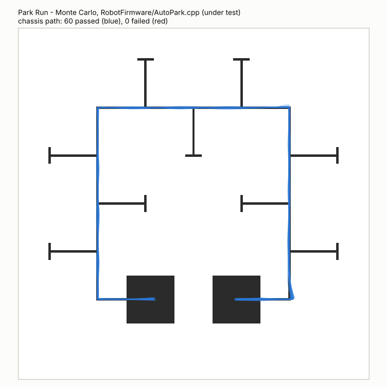
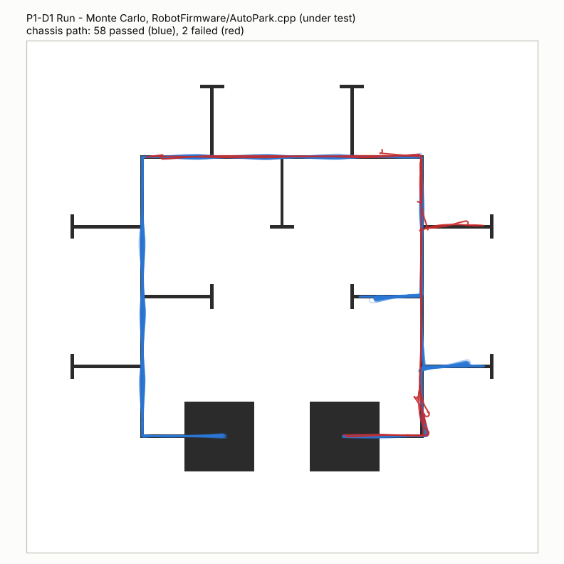
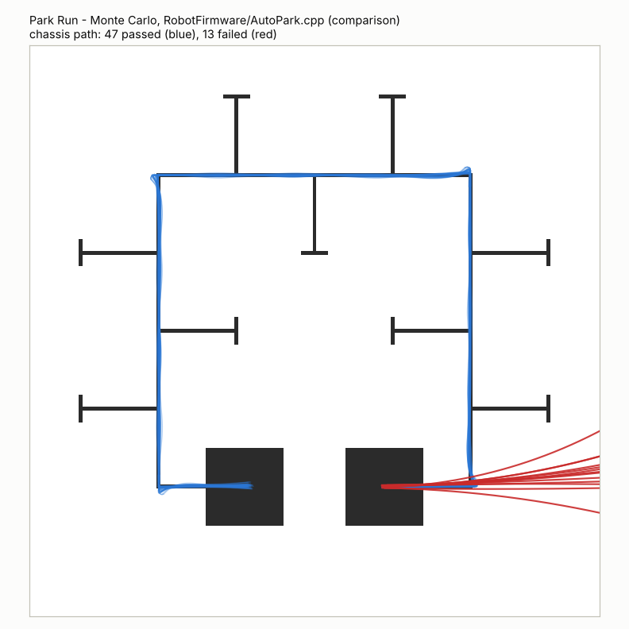
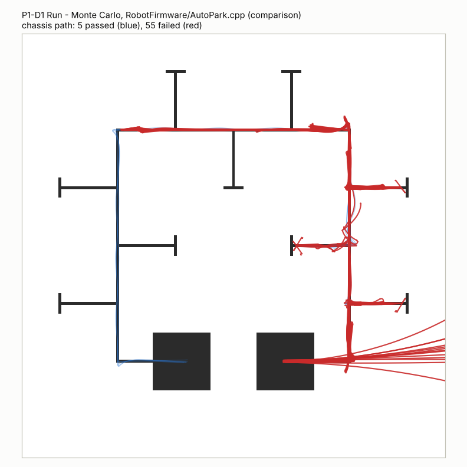
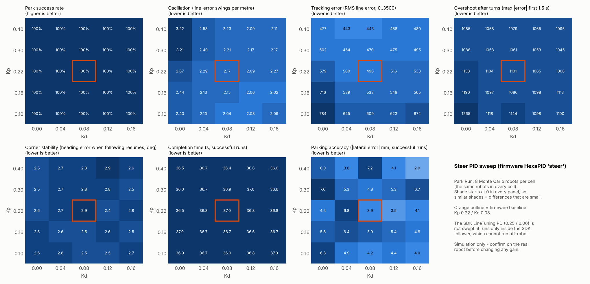

# GLITCHED Pixel - AutoPark software-in-the-loop validation report

Generated 2026-11-20T06:32:34 on Linux-6.18.44-fc-v726-x86_64-with-glibc2.39 by `python3 main.py report`. Every number below comes from simulation runs made by that command. **This is simulation evidence, not hardware validation.** Results rest on the parameters in `config/`, several of which are ASSUMPTIONS (listed in section 4).

Engineering interpretation of these results (written by hand, with the run evidence it rests on): [FINDINGS.md](FINDINGS.md).

## 1. What ran

The C++ file `AutoPark.cpp` was compiled **unchanged** (no copy, no edit) together with `simulation/core/` - a stand-in for the NRL SDK v1.5.0 runtime written from its public headers, plus robot physics, virtual sensors and fault injection. The firmware's own state machine, constants, PID and encoder interrupt handlers make every decision. It is **not** the ESP32 binary: the SDK's prebuilt runtime libraries cannot execute off the robot, so their documented behaviour is re-implemented (section 2).

| role | file | sha256 |
|---|---|---|
| under test | `/mnt/user-data/outputs/RobotFirmware/opmodes/AutoPark.cpp` | `bb6793db9c27b151...` |
| comparison | `/home/claude/smarthomepeople/glitch/RobotFirmware/opmodes/AutoPark.cpp` | `1f4ebdb127f5e272...` |

## 2. SDK runtime: simulator equivalents

| SDK behaviour | source | simulator implementation | fidelity | note |
|---|---|---|---|---|
| HexaLineArray::tick() normalisation | HexaLineArray.h | (raw-calMin)/(calMax-calMin)*1000, clamped 0..1000 | exact (header formula) |  |
| HexaLineArray dark mask | HexaLineArray.h | norm >= darkThreshold (250) | exact |  |
| HexaLineArray dead channel | HexaLineArray.h | span < minSpan (300) -> always 0 | exact |  |
| HexaLineArray::position() | HexaLineArray.h | sum(norm*i*1000)/sum(norm) over channels >= weightThreshold | exact |  |
| position() during dropout | HexaLineArray.h | 0 or 7000 on the last-seen side; -1 after lostStopMs (1200 ms) | exact |  |
| lastSeenSide() | HexaLineArray.h | set from the sign of every non-zero on-line error; never reset to 0 | approximated | ASSUMPTION: the exact update rule is in the .a |
| HexaLineArray::pattern() | HexaLineArray.h | zones ch0-1 / ch3-4 / ch6-7, TERMINAL >= 7 dark | approximated | ASSUMPTION: middle = ch3 OR ch4; both edges -> LEFT_BRANCH. AutoPark's own logic reads mask(), not pattern(), for its decisions |
| IR analog front end | - | white/black raw levels + Gaussian noise + spot coverage of tape | model | ASSUMPTION values in sensor.json |
| HexaDCMotor::setSpeed() | HexaDCMotor.h | /cmd/ <= 10 -> 0; minDrive remaps 1..255 onto minDrive..255; 0 = coast | approximated | ASSUMPTION: the remap is linear |
| TankDrive::drive()/tick | TankDrive.h | L=(f+t)*scale, R=(f-t)*scale; ramp _maxDelta per tick; output*255 | exact / approx | ASSUMPTION: output*255 rounded |
| TankDrive::stop() | TankDrive.h | command and output to 0 at once, no ramp | exact |  |
| HexaPID::update() | HexaPID.h | dt from micros capped at maxDtMs; D filter dAlpha; no D on first update; iMax + anti-windup | exact (header doc) |  |
| NRLOpMode tick | NRLOpMode.h | line tick -> actions FIRST -> loop() -> TankDrive::tickAll -> physics | exact (header doc) |  |
| runAction() | NRLOpMode.h | queued; starts on the next tick; max 8 | exact (header doc) |  |
| sequential() | NRLAction.h | next child starts on the next tick | approximated | ASSUMPTION (seq_chain=1 chains in the same tick) |
| LineActions::leaveBox() | LineActions.h + LineTuning.h | startSpeed straight until ch3/ch4 dark and ch0,1,6,7 white for boxLeaveTicks; NO_LINE after startTimeoutMs | approximated | ASSUMPTION: no gyro heading hold unless sdk_leavebox_gyro_hold=1. Used only by the repo V3 Park Run |
| LineActions builder (followToJunction etc.) | LineActions.h | NOT simulated | not simulated | the SDK follower lives in the prebuilt .a; affects only the fallback OpModes 'Park Run Tape' and 'First Junction' |
| LineTuning.pid (SDK follower PD 0.25/0.06) | LineTuning.h | NOT simulated | not simulated | used only inside the SDK follower (.a). Park Run / P1-D1 Run steer with their own HexaPID 'steer' |
| NRLComms heading | NRLComms.h | true heading CW+ + bias, drift, noise, scale; zeroHeading() reference | model | noise/drift values are ASSUMPTIONS |
| Encoders | AutoPark.cpp ISR | pulses delivered to AutoPark's own leftIsr/rightIsr (with its 50 us glitch filter) on pins 37/36 | exact (firmware ISR runs) | channel A only: a 'wrong direction' fault is not observable and is not simulated |

### Stand-in SDK vs the real headers (automated check)

| item | matches | detail |
|---|---|---|
| struct HexaPIDConfig (HexaPID.h) | yes | 8 fields match |
| struct HexaLineArrayConfig (HexaLineArray.h) | yes | 12 fields match |
| struct HexaDCMotorConfig (HexaDCMotor.h) | yes | 4 fields match |
| struct LineTuning (LineTuning.h) | yes | 15 fields match |
| enum LineFault (LineActions.h) | yes | 10 values in order |
| enum LinePattern (HexaLineArray.h) | yes | 5 values in order |
| enum LineSide (LineActions.h) | yes | 3 values in order |
| enum OpModeType (OpModeRegistry.h) | yes | 2 values in order |
| MOTOR_DEADBAND (HexaDCMotor.h) | yes | real 10.0 vs stand-in 10.0 |
| DIGITAL_D1 (BoardPins.h) | yes | real 35.0 vs stand-in 35.0 |
| DIGITAL_D2 (BoardPins.h) | yes | real 36.0 vs stand-in 36.0 |
| DIGITAL_D3 (BoardPins.h) | yes | real 37.0 vs stand-in 37.0 |
| TankDrive default ramp _maxDelta (TankDrive.h) | yes | real 0.1 vs stand-in 0.1 |
| tick order: actions then loop() (NRLOpMode.h) | yes | documented in NRLOpMode.h |

### Source manifest

| file | status vs accepted manifest |
|---|---|
| RobotFirmware/opmodes/AutoPark.cpp | ok |
| sdk/BoardPins.h | ok |
| sdk/HexaDCMotor.h | ok |
| sdk/HexaLineArray.h | ok |
| sdk/HexaPID.h | ok |
| sdk/LineActions.h | ok |
| sdk/LineTuning.h | ok |
| sdk/NRLAction.h | ok |
| sdk/NRLComms.h | ok |
| sdk/NRLOpMode.h | ok |
| sdk/OpModeRegistry.h | ok |
| sdk/TankDrive.h | ok |
| simulation/core/sdk/NRL.h | ok |
| simulation/core/sim_core.cpp | ok |

## 3. Firmware parameters

Every constant below is used **exactly**: the simulator compiles this file, it does not copy values. Simulator equivalent = the same symbol in the same compiled code.

| C++ name | value in source | type | simulator | copied exactly? |
|---|---|---|---|---|
| `LEFT_ENC_PIN` | `DIGITAL_D3` | int | compiled from source | yes |
| `RIGHT_ENC_PIN` | `DIGITAL_D2` | int | compiled from source | yes |
| `CPM` | `1300.0f` | float | compiled from source | yes |
| `GLITCH_US` | `50` | uint32_t | compiled from source | yes |
| `SIDE_M` | `2.00f` | float | compiled from source | yes |
| `FIRST_LEG_M` | `0.28f` | float | compiled from source | yes |
| `LAST_LEG_M` | `0.30f` | float | compiled from source | yes |
| `PIVOT_FWD_M` | `0.08f` | float | compiled from source | yes |
| `TURN_ROLL_M` | `0.08f` | float | compiled from source | yes |
| `WINDOW_M` | `0.20f` | float | compiled from source | yes |
| `SLOW_M` | `0.30f` | float | compiled from source | yes |
| `PARK_IN_M` | `0.25f + PIVOT_FWD_M` | float | compiled from source | yes |
| `FOLLOW_SPEED` | `0.35f` | float | compiled from source | yes |
| `APPROACH_SPEED` | `0.22f` | float | compiled from source | yes |
| `CREEP_SPEED` | `0.18f` | float | compiled from source | yes |
| `JUNCTION_SPEED` | `0.25f` | float | compiled from source | yes |
| `ROLL_SPEED` | `0.22f` | float | compiled from source | yes |
| `TURN_FAST` | `0.20f` | float | compiled from source | yes |
| `TURN_SLOW` | `0.17f` | float | compiled from source | yes |
| `CORR_SPEED` | `0.17f` | float | compiled from source | yes |
| `MAX_CORRECTIONS` | `0` | int | compiled from source | yes |
| `SPEED_DROP` | `0.50f` | float | compiled from source | yes |
| `RAMP_RATE` | `0.10f` | float | compiled from source | yes |
| `MAX_STEER_STEP` | `0.025f` | float | compiled from source | yes |
| `STEER_SIGN` | `1` | int | compiled from source | yes |
| `TURN_DEG` | `90.0f` | float | compiled from source | yes |
| `STOP_EARLY_DEG` | `8.0f` | float | compiled from source | yes |
| `TURN_TOL_DEG` | `4.0f` | float | compiled from source | yes |
| `SWEEP_DEG` | `25.0f` | float | compiled from source | yes |
| `MAX_SPIN_DEG` | `120.0f` | float | compiled from source | yes |
| `WOBBLE_DEG` | `60.0f` | float | compiled from source | yes |
| `CENTRE_ERR` | `250` | int | compiled from source | yes |
| `LATERAL_MAX` | `1800` | int | compiled from source | yes |
| `LATERAL_OK` | `800` | int | compiled from source | yes |
| `FLICKER_M` | `0.04f` | float | compiled from source | yes |
| `CENTRE_PASSES` | `3` | int | compiled from source | yes |
| `LEG_START_M` | `0.15f` | float | compiled from source | yes |
| `NEAR_CORNER_M` | `0.40f` | float | compiled from source | yes |
| `SLOW_DEG` | `45.0f` | float | compiled from source | yes |
| `TAPE_ACCEPT_ERR` | `1200` | int | compiled from source | yes |
| `CORNER_DIR` | `-1` | int | compiled from source | yes |
| `LOST_TICKS` | `3` | int | compiled from source | yes |
| `TAPE_PARK_MS` | `400` | long | compiled from source | yes |
| `TERM_M` | `0.50f` | float | compiled from source | yes |
| `GAP_M` | `0.50f` | float | compiled from source | yes |
| `BRANCH_ROLL_M` | `PIVOT_FWD_M + 0.05f` | float | compiled from source | yes |
| `MIN_EVENT_M` | `0.05f` | float | compiled from source | yes |
| `WIDE_COUNT` | `5` | int | compiled from source | yes |
| `CONFIRM_TICKS` | `3` | int | compiled from source | yes |
| `BACKUP_MAX_M` | `0.08f` | float | compiled from source | yes |
| `UTURN_BACK_M` | `0.08f` | float | compiled from source | yes |
| `BAR_MIN_DARK` | `6` | int | compiled from source | yes |
| `LINE_HALF_M` | `0.0125f` | float | compiled from source | yes |
| `LOCATE_SPEED` | `0.16f` | float | compiled from source | yes |
| `LOCATE_MAX_M` | `0.15f` | float | compiled from source | yes |
| `CORNER_TRIM_M` | `0.0f` | float | compiled from source | yes |
| `BRANCH_TRIM_M` | `0.0f` | float | compiled from source | yes |
| `RIGHT_TURN_TRIM_M` | `-0.015f` | float | compiled from source | yes |
| `SENSOR_PITCH_M` | `0.010f` | float | compiled from source | yes |
| `LEARN_GAIN` | `0.5f` | float | compiled from source | yes |
| `LEARN_MAX_M` | `0.04f` | float | compiled from source | yes |
| `CROSS_ZONE_M` | `0.10f` | float | compiled from source | yes |
| `HOLD_KP` | `0.010f` | float | compiled from source | yes |
| `HOLD_MAX` | `0.12f` | float | compiled from source | yes |
| `TERMINAL_SPEED` | `0.20f` | float | compiled from source | yes |
| `BAR_CREEP_SPEED` | `0.14f` | float | compiled from source | yes |
| `BAR_CREEP_M` | `0.15f` | float | compiled from source | yes |
| `OFF_COURSE_DEG` | `30.0f` | float | compiled from source | yes |
| `SOFT_TURN` | `0.12f` | float | compiled from source | yes |
| `GRID_TOL_DEG` | `2.0f` | float | compiled from source | yes |
| `GRID_PASSES` | `4` | int | compiled from source | yes |
| `USE_SDK_LEAVEBOX` | `false` | bool | compiled from source | yes |
| `LEAVE_SPEED` | `0.22f` | float | compiled from source | yes |
| `LEAVE_EXTRA_M` | `0.06f` | float | compiled from source | yes |
| `LATERAL_MAX_DEG` | `10.0f` | float | compiled from source | yes |
| `COAST_GUESS_M` | `0.02f` | float | compiled from source | yes |
| `NUDGE_MS_PER_DEG` | `8.0f` | float | compiled from source | yes |
| `BRANCH_MAX_ANGLE` | `12.0f` | float | compiled from source | yes |
| `HexaPID steer` | `{.kP = 0.22f, .kD = 0.08f, .outMin = -0.25f, .outMax = 0.25f, .dAlpha = 0.5f}` | HexaPIDConfig | compiled from source | yes |
| `LineTuning.pid` | `HexaPIDConfig{ .kP = 0.25f, .kD = 0.06f, .dAlpha = 0.5f }` | LineTuning | compiled from source | yes |
| `LineTuning.rampRate` | `0.12f` | LineTuning | compiled from source | yes |
| `HexaDCMotor leftMotor` | `{.dirPin = MOTOR_L_DIR, .pwmPin = MOTOR_L_PWM, .minDrive = 34}` | HexaDCMotorConfig | compiled from source | yes |
| `HexaDCMotor rightMotor` | `{.dirPin = MOTOR_R_DIR, .pwmPin = MOTOR_R_PWM, .flipped = true, .minDrive = 32}` | HexaDCMotorConfig | compiled from source | yes |

**PARK_PLAN**: C1 (CORNER, FIRST_LEG_M) -> C2 (CORNER, SIDE_M - PIVOT_FWD_M) -> C3 (CORNER, SIDE_M - PIVOT_FWD_M) -> C4 (CORNER, SIDE_M - PIVOT_FWD_M) -> BOX (BOX, LAST_LEG_M - PIVOT_FWD_M)

**P1D1_PLAN**: C1 (CORNER, FIRST_LEG_M) -> to P1 (BRANCH_R, GAP_M - PIVOT_FWD_M) -> P1 end (END_BAR, TERM_M - PIVOT_FWD_M) -> P1 back (MAIN_LINE, TERM_M - 2.0f * PIVOT_FWD_M - UTURN_BACK_M) -> to D1 (BRANCH_L, GAP_M - PIVOT_FWD_M) -> D1 end (END_BAR, TERM_M - PIVOT_FWD_M) -> D1 back (MAIN_LINE, TERM_M - 2.0f * PIVOT_FWD_M - UTURN_BACK_M) -> C2 (CORNER, 2.0f * GAP_M - PIVOT_FWD_M) -> C3 (CORNER, SIDE_M - PIVOT_FWD_M) -> C4 (CORNER, SIDE_M - PIVOT_FWD_M) -> BOX (BOX, LAST_LEG_M - PIVOT_FWD_M)

## 4. Robot and world parameters (configs)

| parameter | value | source | note |
|---|---|---|---|
| `wheel_radius_m` | 0.05 | measured | 100 mm wheels |
| `track_width_m` | 0.316 | measured | middle of left wheels to middle of right wheels |
| `skid_factor` | 1.42 | **ASSUMPTION** | 4-wheel skid-steer turns slower than ideal diff-drive; effective track = track_width_m x skid_factor (0.45 m). Fitted in the earlier sim to the observed turn behaviour, not measured directly |
| `wheelbase_m` | 0.2 | **ASSUMPTION** | front-to-rear axle spacing; NOT measured. Used only for the 'all wheel contact points inside PARK' check |
| `motor_rpm` | 300 | measured | Johnson 300 RPM at 12 V (motor label) |
| `motor_gain_l` | 1.0 | derived | relative strength of the left side |
| `motor_gain_r` | 1.05 | derived | right ~5% faster: the robot veered left ~6 cm per metre (Encoder Accuracy runs, 2026-11-19) |
| `thr_straight_l` | 24.5 | measured | Min Drive: PWM at which the left side starts moving, straight |
| `thr_straight_r` | 22.5 | measured | Min Drive, straight |
| `thr_pivot_l` | 29.0 | measured | Min Drive, pivot (median) |
| `thr_pivot_r` | 23.0 | measured | Min Drive, pivot (median) |
| `kinetic_ratio` | 0.8 | **ASSUMPTION** | once rolling, the threshold drops to this fraction (static vs kinetic friction) |
| `tau_up_s` | 0.08 | **ASSUMPTION** | time constant speeding up (motor + robot inertia) |
| `tau_down_s` | 0.08 | **ASSUMPTION** | time constant slowing down under drive |
| `tau_coast_s` | 0.1 | **ASSUMPTION** | time constant when the motor output is 0 (coast). Sets how far the robot rolls after stop() |
| `slip_long` | 0.97 | **ASSUMPTION** | ground travel / wheel surface travel |
| `dt_s` | 0.01 | header | the NRL runtime ticks at 100 Hz (LineTuning.h: 'robot ticks (10 ms each at 100 Hz)') |
| `timeout_s` | 150 | rules | Autonomous Skill Challenge run time |
| `stuck_s` | 8 | simulator | no motion for this long while not DONE/FAULT = STUCK |
| `seq_chain` | 0 | **ASSUMPTION** | 0: sequential() advances one child per tick. 1: chains finished children in the same tick |
| `sensor_fwd_m` | 0.08 | measured | sensor bar ahead of the middle of the chassis (8 cm, 2026-11-19) = PIVOT_FWD_M in AutoPark |
| `sensor_pitch_m` | 0.01 | **ASSUMPTION** | spacing between IR channels - NOT measured (AutoPark SENSOR_PITCH_M is the same placeholder) |
| `sensor_spot_radius_m` | 0.003 | **ASSUMPTION** | radius of the patch each IR channel sees |
| `sensor_lateral_offset_m` | 0.0 | **ASSUMPTION** | bar centre offset to the robot's left (+) |
| `sensor_angle_deg` | 0.0 | **ASSUMPTION** | bar rotated on the chassis |
| `sensor_dead_mask` | 128 | measured | bit i = channel i dead. 128 = channel 7 dead (2026-11-19) |
| `raw_white` | 400 | **ASSUMPTION** | raw ADC over white (12-bit); white reads LOW (HexaLineArray.h) |
| `raw_black` | 3000 | **ASSUMPTION** | raw ADC over black tape |
| `raw_noise` | 40 | **ASSUMPTION** | 1-sigma raw ADC noise per read |
| `cal_noise` | 10 | **ASSUMPTION** | 1-sigma error of the LINE TEST calibration references |
| `enc_pin_l` | 37 | firmware | LEFT_ENC_PIN = DIGITAL_D3 (GPIO37) |
| `enc_pin_r` | 36 | firmware | RIGHT_ENC_PIN = DIGITAL_D2 (GPIO36) |
| `enc_cpm_l` | 1250 | derived | true pulses per metre of left wheel surface. Firmware assumes CPM 1300 for both; the Encoder Accuracy run read L 0.99 m vs R 1.03 m over the same drive |
| `enc_cpm_r` | 1350 | derived | see enc_cpm_l |
| `gyro_noise_deg` | 0.05 | **ASSUMPTION** | 1-sigma heading noise |
| `gyro_bias_deg` | 0.0 | **ASSUMPTION** | constant offset (cancels on zeroHeading) |
| `gyro_drift_dps` | 0.02 | **ASSUMPTION** | heading drift, deg per second |
| `gyro_scale` | 1.0 | **ASSUMPTION** | turn-rate scale error |
| `gyro_ready_ms` | 0 | **ASSUMPTION** | isHeadingReady() false until this time |
| `sdk_leavebox_gyro_hold` | 0 | **ASSUMPTION** | Does the SDK's leaveBox() hold heading with the gyro? LineActions.h only says 'straight out'. 0 = open loop (default), 1 = gyro hold. Only the repo V3 Park Run uses leaveBox(); the candidate uses its own LEAVE state |

## 5. Results

### Park Run - firmware under test

**Fault-injection suite** (each scenario on 3 seeds; verdict PASS only if every seed parked):

| # | scenario | what it means | verdict | pass/safe/fail | mean t (s) | why |
|---|---|---|---|---|---|---|
| 1 | Ideal conditions | all 8 channels work, no noise, symmetric motors and encoders | PASS | 3/0/0 | 35.5 | parked: all 4 wheels inside PARK on every seed |
| 2 | Sensor channel 7 dead | ideal, except channel 7 reads white always (as on Pixel) | PASS | 3/0/0 | 35.3 | parked: all 4 wheels inside PARK on every seed |
| 3 | Sensor noise | 5x the nominal ADC noise | PASS | 3/0/0 | 35.5 | parked: all 4 wheels inside PARK on every seed |
| 4 | Encoder left disconnected | left encoder never pulses | FAIL | 0/2/1 | 18.0 | run ended FAULT (no line) / run ended FAULT (no line); left the route by 641 mm; 2 turn(s) away from any planned turn point / run ended FAULT (off course) |
| 5 | Encoder right disconnected | right encoder never pulses | SAFE FAIL | 0/3/0 | 12.4 | run ended FAULT (off course) |
| 6 | Both encoders disconnected | no distance at all | PASS | 3/0/0 | 27.0 | parked: all 4 wheels inside PARK on every seed |
| 7 | Gyro unavailable | isHeadingReady() never true | PASS | 3/0/0 | 34.4 | parked: all 4 wheels inside PARK on every seed |
| 8 | Gyro drift | 0.5 deg/s drift (25x nominal) | PASS | 3/0/0 | 39.7 | parked: all 4 wheels inside PARK on every seed |
| 9 | Left motor weaker | left side 15% weaker | PASS | 3/0/0 | 37.5 | parked: all 4 wheels inside PARK on every seed |
| 10 | Right motor weaker | right side 10% weaker than left (instead of 5% stronger) | PASS | 3/0/0 | 36.5 | parked: all 4 wheels inside PARK on every seed |
| 11 | Low motor speed | both sides 25% slower (low battery); start thresholds unchanged | PASS | 3/0/0 | 40.7 | parked: all 4 wheels inside PARK on every seed |
| 12 | High motor speed | both sides 25% faster (fresh battery / lighter robot) | PASS | 3/0/0 | 34.3 | parked: all 4 wheels inside PARK on every seed |
| 13 | Excessive motor ramp | motors+chassis respond 3x slower. The firmware's own RAMP_RATE is NOT changed (that would be editing the controller) | FAIL | 0/0/3 | 18.0 | run ended FAULT (off course); left the route by 367 mm / run ended FAULT (off course); left the route by 385 mm / run ended FAULT (off course); left the route by 450 mm |
| 14 | Incorrect start position | placed 12 cm back and 3 cm left of the START centre | PASS | 3/0/0 | 36.6 | parked: all 4 wheels inside PARK on every seed |
| 15 | Incorrect start heading | placed turned 6 deg left | PASS | 3/0/0 | 40.2 | parked: all 4 wheels inside PARK on every seed |
| 16 | Slight lateral sensor offset | sensor bar mounted 6 mm left of the chassis centre line | PASS | 3/0/0 | 35.5 | parked: all 4 wheels inside PARK on every seed |
| 17 | Starts too close to the edge of Start | chassis 15 cm forward: sensor bar 2 cm from the box's front edge | PASS | 3/0/0 | 35.2 | parked: all 4 wheels inside PARK on every seed |
| 18 | Intermittent line loss | about once a second all channels read white for 50 ms | FAIL | 1/0/2 | 15.9 | run ended FAULT (no line); 2 turn(s) away from any planned turn point |
| 19 | Corner detected earlier than expected | encoders under-count 8%: corners arrive ~15 cm before the firmware's prediction | PASS | 3/0/0 | 35.0 | parked: all 4 wheels inside PARK on every seed |
| 20 | Corner detected later than expected | encoders over-count 8%: corners arrive ~15 cm after the prediction | PASS | 3/0/0 | 35.8 | parked: all 4 wheels inside PARK on every seed |
| 21 | Park Zone detected late | PARK box 10 cm further from C4 than LAST_LEG_M says | PASS | 3/0/0 | 35.8 | parked: all 4 wheels inside PARK on every seed |
| 22 | Robot overshoots the Park Zone | long coast after stop() (slippery mat): the robot rolls on | FAIL | 0/0/3 | 17.0 | run ended FAULT (no line); left the route by 345 mm; 3 turn(s) away from any planned turn point / run ended FAULT (no line); left the route by 353 mm; 3 turn(s) away from any planned turn point / run ended FAULT (no line); left the route by 552 mm; 3 turn(s) away from any planned turn point; spun 242 deg in one go (limit 210) |

**Monte Carlo** (60 randomised robots, ranges in `config/montecarlo.json`):

| metric | value |
|---|---|
| success rate | 100% (60/60) |
| safe fails / fails | 0 / 0 |
| completion time mean (min-max), s | 36.99 (32.36-43.96) |
| final lateral error mean / max, mm | 6.82 / 19.6 |
| final heading error mean / max, deg | 1.72 / 6.15 |
| recoveries (S + T turns) | 1 |
| faults | 0 |
| max line error while following | 3500 |
| missed turns (DONE runs) / turns away from plan | 0 / 0 |
| failure reasons | - |



### P1-D1 Run - firmware under test

**Fault-injection suite** (each scenario on 3 seeds; verdict PASS only if every seed parked):

| # | scenario | what it means | verdict | pass/safe/fail | mean t (s) | why |
|---|---|---|---|---|---|---|
| 1 | Ideal conditions | all 8 channels work, no noise, symmetric motors and encoders | PASS | 3/0/0 | 67.8 | parked: all 4 wheels inside PARK on every seed |
| 2 | Sensor channel 7 dead | ideal, except channel 7 reads white always (as on Pixel) | PASS | 3/0/0 | 67.7 | parked: all 4 wheels inside PARK on every seed |
| 3 | Sensor noise | 5x the nominal ADC noise | PASS | 3/0/0 | 70.1 | parked: all 4 wheels inside PARK on every seed |
| 4 | Encoder left disconnected | left encoder never pulses | SAFE FAIL | 0/3/0 | 36.1 | run ended FAULT (missed branch) / run ended FAULT (no line at turn) |
| 5 | Encoder right disconnected | right encoder never pulses | SAFE FAIL | 0/3/0 | 16.0 | run ended FAULT (no line) |
| 6 | Both encoders disconnected | no distance at all | FAIL | 1/0/2 | 49.3 | run ended FAULT (no line); left the route by 492 mm; 6 turn(s) away from any planned turn point |
| 7 | Gyro unavailable | isHeadingReady() never true | PASS | 3/0/0 | 65.9 | parked: all 4 wheels inside PARK on every seed |
| 8 | Gyro drift | 0.5 deg/s drift (25x nominal) | SAFE FAIL | 0/3/0 | 32.2 | run ended FAULT (missed branch) |
| 9 | Left motor weaker | left side 15% weaker | PASS | 3/0/0 | 86.8 | parked: all 4 wheels inside PARK on every seed |
| 10 | Right motor weaker | right side 10% weaker than left (instead of 5% stronger) | PASS | 3/0/0 | 73.1 | parked: all 4 wheels inside PARK on every seed |
| 11 | Low motor speed | both sides 25% slower (low battery); start thresholds unchanged | PASS | 3/0/0 | 81.6 | parked: all 4 wheels inside PARK on every seed |
| 12 | High motor speed | both sides 25% faster (fresh battery / lighter robot) | PASS | 3/0/0 | 65.1 | parked: all 4 wheels inside PARK on every seed |
| 13 | Excessive motor ramp | motors+chassis respond 3x slower. The firmware's own RAMP_RATE is NOT changed (that would be editing the controller) | FAIL | 0/0/3 | 18.1 | run ended FAULT (missed branch); left the route by 313 mm / run ended FAULT (missed branch); left the route by 316 mm / run ended FAULT (missed branch); left the route by 319 mm |
| 14 | Incorrect start position | placed 12 cm back and 3 cm left of the START centre | PASS | 3/0/0 | 70.2 | parked: all 4 wheels inside PARK on every seed |
| 15 | Incorrect start heading | placed turned 6 deg left | PASS | 3/0/0 | 75.9 | parked: all 4 wheels inside PARK on every seed |
| 16 | Slight lateral sensor offset | sensor bar mounted 6 mm left of the chassis centre line | PASS | 3/0/0 | 67.0 | parked: all 4 wheels inside PARK on every seed |
| 17 | Starts too close to the edge of Start | chassis 15 cm forward: sensor bar 2 cm from the box's front edge | PASS | 3/0/0 | 69.2 | parked: all 4 wheels inside PARK on every seed |
| 18 | Intermittent line loss | about once a second all channels read white for 50 ms | FAIL | 1/0/2 | 28.8 | run ended FAULT (no line); 2 turn(s) away from any planned turn point |
| 19 | Corner detected earlier than expected | encoders under-count 8%: corners arrive ~15 cm before the firmware's prediction | PASS | 3/0/0 | 67.8 | parked: all 4 wheels inside PARK on every seed |
| 20 | Corner detected later than expected | encoders over-count 8%: corners arrive ~15 cm after the prediction | PASS | 3/0/0 | 69.9 | parked: all 4 wheels inside PARK on every seed |
| 21 | Park Zone detected late | PARK box 10 cm further from C4 than LAST_LEG_M says | PASS | 3/0/0 | 69.8 | parked: all 4 wheels inside PARK on every seed |
| 22 | Robot overshoots the Park Zone | long coast after stop() (slippery mat): the robot rolls on | FAIL | 0/0/3 | 12.4 | run ended FAULT (missed branch); left the route by 344 mm; 1 turn(s) away from any planned turn point / run ended FAULT (missed branch); left the route by 350 mm; 1 turn(s) away from any planned turn point / run ended FAULT (missed branch); left the route by 363 mm; 1 turn(s) away from any planned turn point |

**Monte Carlo** (60 randomised robots, ranges in `config/montecarlo.json`):

| metric | value |
|---|---|
| success rate | 97% (58/60) |
| safe fails / fails | 0 / 2 |
| completion time mean (min-max), s | 72.98 (63.83-84.54) |
| final lateral error mean / max, mm | 7.54 / 21.9 |
| final heading error mean / max, deg | 1.91 / 5.88 |
| recoveries (S + T turns) | 4 |
| faults | 2 |
| max line error while following | 3500 |
| missed turns (DONE runs) / turns away from plan | 0 / 5 |
| failure reasons | run ended FAULT (no line) x2 |



<details><summary>First failed Monte Carlo runs (event log tails)</summary>

```
seed 1030: run ended FAULT (no line); 1 turn(s) away from any planned turn point
    42.18 STATE VERIFY -> LOCATE [P1 back exp 26] why=off window @(1.995,1.987,93.4deg)
    42.72 STATE LOCATE -> ADJUST [P1 back exp 26] why=edge not found @(2.000,1.835,91.0deg)
    42.97 STATE ADJUST -> STOP [P1 back exp 26] why=edge not found @(2.001,1.741,89.5deg)
    43.77 STATE STOP -> TAPE TURN [P1 back exp 26] why=edge not found @(2.000,1.692,88.7deg)
    45.34 STATE TAPE TURN -> FAULT [P1 back exp 26] why=no line @(1.973,1.677,-32.1deg)
    47.34 END FAULT
seed 1055: run ended FAULT (no line); left the route by 442 mm; 4 turn(s) away from any planned turn point
    57.81 STATE VERIFY -> LOCATE [D1 back exp 26] why=off window @(1.982,2.003,356.4deg)
    58.34 STATE LOCATE -> ADJUST [D1 back exp 26] why=edge not found @(1.831,2.014,355.4deg)
    58.57 STATE ADJUST -> STOP [D1 back exp 26] why=edge not found @(1.744,2.021,354.8deg)
    59.37 STATE STOP -> TAPE TURN [D1 back exp 26] why=edge not found @(1.700,2.025,354.5deg)
    60.89 STATE TAPE TURN -> FAULT [D1 back exp 26] why=no line @(1.716,2.048,475.7deg)
    62.89 END FAULT
```
</details>

### Park Run - firmware comparison

**Fault-injection suite** (each scenario on 3 seeds; verdict PASS only if every seed parked):

| # | scenario | what it means | verdict | pass/safe/fail | mean t (s) | why |
|---|---|---|---|---|---|---|
| 1 | Ideal conditions | all 8 channels work, no noise, symmetric motors and encoders | PASS | 3/0/0 | 32.6 | parked: all 4 wheels inside PARK on every seed |
| 2 | Sensor channel 7 dead | ideal, except channel 7 reads white always (as on Pixel) | PASS | 3/0/0 | 32.7 | parked: all 4 wheels inside PARK on every seed |
| 3 | Sensor noise | 5x the nominal ADC noise | PASS | 3/0/0 | 34.8 | parked: all 4 wheels inside PARK on every seed |
| 4 | Encoder left disconnected | left encoder never pulses | SAFE FAIL | 0/3/0 | 8.0 | run ended FAULT (no line at turn) |
| 5 | Encoder right disconnected | right encoder never pulses | SAFE FAIL | 0/3/0 | 7.9 | run ended FAULT (no line at turn) |
| 6 | Both encoders disconnected | no distance at all | PASS | 3/0/0 | 29.6 | parked: all 4 wheels inside PARK on every seed |
| 7 | Gyro unavailable | isHeadingReady() never true | PASS | 3/0/0 | 31.8 | parked: all 4 wheels inside PARK on every seed |
| 8 | Gyro drift | 0.5 deg/s drift (25x nominal) | PASS | 3/0/0 | 42.9 | parked: all 4 wheels inside PARK on every seed |
| 9 | Left motor weaker | left side 15% weaker | FAIL | 0/0/3 | 2.7 | run ended LEFT FIELD; motors still driven at the end; left the route by 814 mm |
| 10 | Right motor weaker | right side 10% weaker than left (instead of 5% stronger) | PASS | 3/0/0 | 33.6 | parked: all 4 wheels inside PARK on every seed |
| 11 | Low motor speed | both sides 25% slower (low battery); start thresholds unchanged | PASS | 3/0/0 | 40.5 | parked: all 4 wheels inside PARK on every seed |
| 12 | High motor speed | both sides 25% faster (fresh battery / lighter robot) | PASS | 3/0/0 | 40.4 | parked: all 4 wheels inside PARK on every seed |
| 13 | Excessive motor ramp | motors+chassis respond 3x slower. The firmware's own RAMP_RATE is NOT changed (that would be editing the controller) | FAIL | 0/0/3 | 69.4 | DONE but only 3/4 wheels inside PARK (pose (629.7, -98.2, -16.9)) / DONE but only 3/4 wheels inside PARK (pose (630.8, -99.6, -17.2)) / DONE but only 3/4 wheels inside PARK (pose (636.2, -78.9, -13.4)) |
| 14 | Incorrect start position | placed 12 cm back and 3 cm left of the START centre | FAIL | 0/0/3 | 2.5 | run ended LEFT FIELD; motors still driven at the end; left the route by 822 mm |
| 15 | Incorrect start heading | placed turned 6 deg left | FAIL | 0/0/3 | 2.4 | run ended LEFT FIELD; motors still driven at the end; left the route by 834 mm |
| 16 | Slight lateral sensor offset | sensor bar mounted 6 mm left of the chassis centre line | PASS | 3/0/0 | 32.9 | parked: all 4 wheels inside PARK on every seed |
| 17 | Starts too close to the edge of Start | chassis 15 cm forward: sensor bar 2 cm from the box's front edge | PASS | 3/0/0 | 32.5 | parked: all 4 wheels inside PARK on every seed |
| 18 | Intermittent line loss | about once a second all channels read white for 50 ms | SAFE FAIL | 2/1/0 | 37.4 | run ended FAULT (no line) |
| 19 | Corner detected earlier than expected | encoders under-count 8%: corners arrive ~15 cm before the firmware's prediction | PASS | 3/0/0 | 32.9 | parked: all 4 wheels inside PARK on every seed |
| 20 | Corner detected later than expected | encoders over-count 8%: corners arrive ~15 cm after the prediction | PASS | 3/0/0 | 32.9 | parked: all 4 wheels inside PARK on every seed |
| 21 | Park Zone detected late | PARK box 10 cm further from C4 than LAST_LEG_M says | PASS | 3/0/0 | 32.9 | parked: all 4 wheels inside PARK on every seed |
| 22 | Robot overshoots the Park Zone | long coast after stop() (slippery mat): the robot rolls on | FAIL | 0/0/3 | 17.3 | run ended FAULT (no line); left the route by 335 mm; 3 turn(s) away from any planned turn point; spun 252 deg in one go (limit 210) / run ended FAULT (no line); left the route by 336 mm; 3 turn(s) away from any planned turn point; spun 251 deg in one go (limit 210) / run ended FAULT (no line); left the route by 339 mm; 3 turn(s) away from any planned turn point; spun 251 deg in one go (limit 210) |

**Monte Carlo** (60 randomised robots, ranges in `config/montecarlo.json`):

| metric | value |
|---|---|
| success rate | 78% (47/60) |
| safe fails / fails | 0 / 13 |
| completion time mean (min-max), s | 40.79 (30.59-63.129999999999995) |
| final lateral error mean / max, mm | 9.52 / 30.2 |
| final heading error mean / max, deg | 2.17 / 6.25 |
| recoveries (S + T turns) | 4 |
| faults | 0 |
| max line error while following | 3500 |
| missed turns (DONE runs) / turns away from plan | 0 / 0 |
| failure reasons | run ended LEFT FIELD x13 |



<details><summary>First failed Monte Carlo runs (event log tails)</summary>

```
seed 1007: run ended LEFT FIELD; motors still driven at the end; left the route by 807 mm
    1.00 START Park Run
    1.01 STATE  -> FOLLOW [C1 exp 28] why=- @(1.435,0.008,0.5deg)
    1.01 TURN log=- @(1.435,0.008,0.5deg)
    1.01 STEP C1 exp 28 @(1.435,0.008,0.5deg)
    3.35 END LEFT FIELD
seed 1008: run ended LEFT FIELD; motors still driven at the end; left the route by 849 mm
    1.00 START Park Run
    1.01 STATE  -> FOLLOW [C1 exp 28] why=- @(1.436,-0.008,-1.1deg)
    1.01 TURN log=- @(1.436,-0.008,-1.1deg)
    1.01 STEP C1 exp 28 @(1.436,-0.008,-1.1deg)
    3.46 END LEFT FIELD
seed 1011: run ended LEFT FIELD; motors still driven at the end; left the route by 828 mm
    1.00 START Park Run
    1.01 STATE  -> FOLLOW [C1 exp 28] why=- @(1.431,0.007,1.3deg)
    1.01 TURN log=- @(1.431,0.007,1.3deg)
    1.01 STEP C1 exp 28 @(1.431,0.007,1.3deg)
    3.27 END LEFT FIELD
seed 1017: run ended LEFT FIELD; motors still driven at the end; left the route by 814 mm
    1.00 START Park Run
    1.01 STATE  -> FOLLOW [C1 exp 28] why=- @(1.433,0.010,0.6deg)
    1.01 TURN log=- @(1.433,0.010,0.6deg)
    1.01 STEP C1 exp 28 @(1.433,0.010,0.6deg)
    3.44 END LEFT FIELD
seed 1023: run ended LEFT FIELD; motors still driven at the end; left the route by 818 mm
    1.00 START Park Run
    1.01 STATE  -> FOLLOW [C1 exp 28] why=- @(1.434,-0.005,1.5deg)
    1.01 TURN log=- @(1.434,-0.005,1.5deg)
    1.01 STEP C1 exp 28 @(1.434,-0.005,1.5deg)
    3.53 END LEFT FIELD
seed 1025: run ended LEFT FIELD; motors still driven at the end; left the route by 814 mm
    1.00 START Park Run
    1.01 STATE  -> FOLLOW [C1 exp 28] why=- @(1.451,-0.010,-0.9deg)
    1.01 TURN log=- @(1.451,-0.010,-0.9deg)
    1.01 STEP C1 exp 28 @(1.451,-0.010,-0.9deg)
    3.39 END LEFT FIELD
seed 1041: run ended LEFT FIELD; motors still driven at the end; left the route by 835 mm
    1.00 START Park Run
    1.01 STATE  -> FOLLOW [C1 exp 28] why=- @(1.463,0.004,1.8deg)
    1.01 TURN log=- @(1.463,0.004,1.8deg)
    1.01 STEP C1 exp 28 @(1.463,0.004,1.8deg)
    3.36 END LEFT FIELD
seed 1042: run ended LEFT FIELD; motors still driven at the end; left the route by 817 mm
    1.00 START Park Run
    1.01 STATE  -> FOLLOW [C1 exp 28] why=- @(1.468,0.000,1.1deg)
    1.01 TURN log=- @(1.468,0.000,1.1deg)
    1.01 STEP C1 exp 28 @(1.468,0.000,1.1deg)
    3.23 END LEFT FIELD
seed 1043: run ended LEFT FIELD; motors still driven at the end; left the route by 815 mm
    1.00 START Park Run
    1.01 STATE  -> FOLLOW [C1 exp 28] why=- @(1.455,0.008,1.1deg)
    1.01 TURN log=- @(1.455,0.008,1.1deg)
    1.01 STEP C1 exp 28 @(1.455,0.008,1.1deg)
    3.29 END LEFT FIELD
seed 1048: run ended LEFT FIELD; motors still driven at the end; left the route by 822 mm
    1.00 START Park Run
    1.01 STATE  -> FOLLOW [C1 exp 28] why=- @(1.470,0.010,-0.5deg)
    1.01 TURN log=- @(1.470,0.010,-0.5deg)
    1.01 STEP C1 exp 28 @(1.470,0.010,-0.5deg)
    3.38 END LEFT FIELD
```
</details>

### P1-D1 Run - firmware comparison

**Fault-injection suite** (each scenario on 3 seeds; verdict PASS only if every seed parked):

| # | scenario | what it means | verdict | pass/safe/fail | mean t (s) | why |
|---|---|---|---|---|---|---|
| 1 | Ideal conditions | all 8 channels work, no noise, symmetric motors and encoders | SAFE FAIL | 0/3/0 | 41.7 | run ended FAULT (no line at turn) |
| 2 | Sensor channel 7 dead | ideal, except channel 7 reads white always (as on Pixel) | FAIL | 0/0/3 | 62.8 | run ended FAULT (no line); left the route by 435 mm; 4 turn(s) away from any planned turn point |
| 3 | Sensor noise | 5x the nominal ADC noise | FAIL | 0/0/3 | 54.6 | run ended FAULT (no line at turn); left the route by 483 mm; 3 turn(s) away from any planned turn point / run ended FAULT (no line); left the route by 433 mm; 4 turn(s) away from any planned turn point / run ended FAULT (no line); left the route by 436 mm; 6 turn(s) away from any planned turn point |
| 4 | Encoder left disconnected | left encoder never pulses | SAFE FAIL | 0/3/0 | 8.0 | run ended FAULT (no line at turn) |
| 5 | Encoder right disconnected | right encoder never pulses | SAFE FAIL | 0/3/0 | 7.9 | run ended FAULT (no line at turn) |
| 6 | Both encoders disconnected | no distance at all | FAIL | 0/2/1 | 23.3 | run ended FAULT (missed branch) / run ended FAULT (no line); left the route by 434 mm; 5 turn(s) away from any planned turn point |
| 7 | Gyro unavailable | isHeadingReady() never true | FAIL | 0/0/3 | 53.4 | run ended FAULT (no line); left the route by 436 mm; 5 turn(s) away from any planned turn point / run ended FAULT (no line); left the route by 449 mm; 6 turn(s) away from any planned turn point; spun 461 deg in one go (limit 300) / run ended FAULT (no line); left the route by 491 mm; 4 turn(s) away from any planned turn point; spun 420 deg in one go (limit 300) |
| 8 | Gyro drift | 0.5 deg/s drift (25x nominal) | FAIL | 0/0/3 | 36.1 | run ended FAULT (missed branch); left the route by 434 mm; 3 turn(s) away from any planned turn point / run ended FAULT (missed branch); left the route by 436 mm; 3 turn(s) away from any planned turn point / run ended FAULT (no line at turn); left the route by 483 mm; 3 turn(s) away from any planned turn point |
| 9 | Left motor weaker | left side 15% weaker | FAIL | 0/0/3 | 2.7 | run ended LEFT FIELD; motors still driven at the end; left the route by 319 mm |
| 10 | Right motor weaker | right side 10% weaker than left (instead of 5% stronger) | SAFE FAIL | 1/2/0 | 41.9 | run ended FAULT (no line at turn) |
| 11 | Low motor speed | both sides 25% slower (low battery); start thresholds unchanged | FAIL | 0/0/3 | 33.8 | run ended FAULT (missed branch); 1 turn(s) away from any planned turn point / run ended FAULT (no line at turn); 1 turn(s) away from any planned turn point / run ended FAULT (no line at turn); 2 turn(s) away from any planned turn point |
| 12 | High motor speed | both sides 25% faster (fresh battery / lighter robot) | FAIL | 0/0/3 | 67.9 | run ended FAULT (no line); left the route by 443 mm; 4 turn(s) away from any planned turn point |
| 13 | Excessive motor ramp | motors+chassis respond 3x slower. The firmware's own RAMP_RATE is NOT changed (that would be editing the controller) | SAFE FAIL | 0/3/0 | 64.2 | run ended FAULT (missed branch) / run ended FAULT (no line) |
| 14 | Incorrect start position | placed 12 cm back and 3 cm left of the START centre | FAIL | 0/0/3 | 2.5 | run ended LEFT FIELD; motors still driven at the end; left the route by 497 mm |
| 15 | Incorrect start heading | placed turned 6 deg left | FAIL | 0/0/3 | 2.4 | run ended LEFT FIELD; motors still driven at the end; left the route by 432 mm |
| 16 | Slight lateral sensor offset | sensor bar mounted 6 mm left of the chassis centre line | FAIL | 0/0/3 | 58.8 | run ended FAULT (no line); left the route by 434 mm; 4 turn(s) away from any planned turn point / run ended FAULT (no line); left the route by 435 mm; 4 turn(s) away from any planned turn point / run ended FAULT (no line); left the route by 436 mm; 4 turn(s) away from any planned turn point |
| 17 | Starts too close to the edge of Start | chassis 15 cm forward: sensor bar 2 cm from the box's front edge | FAIL | 0/0/3 | 58.5 | run ended FAULT (no line); left the route by 435 mm; 4 turn(s) away from any planned turn point / run ended FAULT (no line); left the route by 436 mm; 4 turn(s) away from any planned turn point |
| 18 | Intermittent line loss | about once a second all channels read white for 50 ms | FAIL | 1/0/2 | 56.4 | run ended FAULT (no line at turn); left the route by 482 mm; 3 turn(s) away from any planned turn point / run ended FAULT (no line); left the route by 436 mm; 4 turn(s) away from any planned turn point |
| 19 | Corner detected earlier than expected | encoders under-count 8%: corners arrive ~15 cm before the firmware's prediction | FAIL | 0/0/3 | 52.9 | run ended FAULT (no line at turn); left the route by 482 mm; 3 turn(s) away from any planned turn point / run ended FAULT (no line); left the route by 434 mm; 4 turn(s) away from any planned turn point / run ended FAULT (no line); left the route by 435 mm; 4 turn(s) away from any planned turn point |
| 20 | Corner detected later than expected | encoders over-count 8%: corners arrive ~15 cm after the prediction | FAIL | 0/0/3 | 59.4 | run ended FAULT (no line); left the route by 435 mm; 4 turn(s) away from any planned turn point / run ended FAULT (no line); left the route by 436 mm; 4 turn(s) away from any planned turn point |
| 21 | Park Zone detected late | PARK box 10 cm further from C4 than LAST_LEG_M says | FAIL | 0/0/3 | 49.2 | run ended FAULT (no line at turn); left the route by 485 mm; 3 turn(s) away from any planned turn point / run ended FAULT (no line); left the route by 436 mm; 4 turn(s) away from any planned turn point |
| 22 | Robot overshoots the Park Zone | long coast after stop() (slippery mat): the robot rolls on | FAIL | 0/0/3 | 12.8 | run ended FAULT (missed branch); left the route by 278 mm; 1 turn(s) away from any planned turn point / run ended FAULT (missed branch); left the route by 279 mm; 1 turn(s) away from any planned turn point |

**Monte Carlo** (60 randomised robots, ranges in `config/montecarlo.json`):

| metric | value |
|---|---|
| success rate | 8% (5/60) |
| safe fails / fails | 20 / 35 |
| completion time mean (min-max), s | 105.02 (74.8-134.41) |
| final lateral error mean / max, mm | 8.62 / 12.0 |
| final heading error mean / max, deg | 2.5 / 4.17 |
| recoveries (S + T turns) | 41 |
| faults | 42 |
| max line error while following | 3500 |
| missed turns (DONE runs) / turns away from plan | 0 / 68 |
| failure reasons | run ended FAULT (no line) x16; run ended FAULT (missed branch) x21; run ended FAULT (no line at turn) x5; run ended LEFT FIELD x13 |



<details><summary>First failed Monte Carlo runs (event log tails)</summary>

```
seed 1000: run ended FAULT (no line); left the route by 436 mm; 4 turn(s) away from any planned turn point
    60.78 STATE VERIFY -> LOCATE [D1 back exp 26] why=off window @(1.976,2.003,358.4deg)
    61.30 STATE LOCATE -> ADJUST [D1 back exp 26] why=edge not found @(1.825,2.009,357.6deg)
    61.61 STATE ADJUST -> STOP [D1 back exp 26] why=edge not found @(1.705,2.014,357.0deg)
    62.26 STATE STOP -> TAPE TURN [D1 back exp 26] why=edge not found @(1.670,2.016,356.8deg)
    63.79 STATE TAPE TURN -> FAULT [D1 back exp 26] why=no line @(1.678,2.028,477.7deg)
    65.79 END FAULT
seed 1001: run ended FAULT (missed branch)
    11.55 STATE CENTRE CHK -> CENTRE [to P1 exp 42] why=no line after squaring @(2.047,0.029,115.6deg)
    11.72 STATE CENTRE -> STOP [to P1 exp 42] why=no line after squaring @(2.046,0.031,124.1deg)
    12.52 STATE STOP -> CENTRE CHK [to P1 exp 42] why=no line after squaring @(2.044,0.033,131.9deg)
    12.53 STATE CENTRE CHK -> FOLLOW [to P1 exp 42] why=no line after squaring @(2.044,0.033,131.9deg)
    18.66 STATE FOLLOW -> FAULT [to P1 exp 42] why=missed branch @(1.971,2.085,116.4deg)
    20.67 END FAULT
seed 1002: run ended FAULT (no line at turn); 1 turn(s) away from any planned turn point
    24.68 STATE STOP -> GYRO TURN [P1 back exp 26] why=no main line @(2.002,0.490,271.2deg)
    25.65 STATE GYRO TURN -> STOP [P1 back exp 26] why=no main line @(2.011,0.501,187.8deg)
    26.25 STATE STOP -> CHECK [P1 back exp 26] why=no main line @(2.012,0.501,182.9deg)
    26.26 STATE CHECK -> SWEEP [P1 back exp 26] why=no line after turn @(2.012,0.501,182.9deg)
    27.43 STATE SWEEP -> FAULT [P1 back exp 26] why=no line at turn @(2.007,0.500,207.4deg)
    29.43 END FAULT
seed 1003: run ended FAULT (no line); left the route by 427 mm; 4 turn(s) away from any planned turn point
    52.57 STATE VERIFY -> LOCATE [D1 back exp 26] why=off window @(1.963,2.005,356.9deg)
    53.11 STATE LOCATE -> ADJUST [D1 back exp 26] why=edge not found @(1.815,2.013,357.0deg)
    53.40 STATE ADJUST -> STOP [D1 back exp 26] why=edge not found @(1.709,2.019,357.1deg)
    54.20 STATE STOP -> TAPE TURN [D1 back exp 26] why=edge not found @(1.686,2.020,357.1deg)
    55.65 STATE TAPE TURN -> FAULT [D1 back exp 26] why=no line @(1.691,2.028,478.3deg)
    57.65 END FAULT
seed 1004: run ended FAULT (no line); left the route by 442 mm; 4 turn(s) away from any planned turn point
    67.60 STATE VERIFY -> LOCATE [D1 back exp 26] why=off window @(1.983,1.998,356.6deg)
    68.15 STATE LOCATE -> ADJUST [D1 back exp 26] why=edge not found @(1.834,2.006,357.1deg)
    68.48 STATE ADJUST -> STOP [D1 back exp 26] why=edge not found @(1.710,2.012,357.4deg)
    69.28 STATE STOP -> TAPE TURN [D1 back exp 26] why=edge not found @(1.665,2.014,357.5deg)
    70.88 STATE TAPE TURN -> FAULT [D1 back exp 26] why=no line @(1.670,2.021,478.8deg)
    72.88 END FAULT
seed 1005: run ended FAULT (no line); left the route by 441 mm; 4 turn(s) away from any planned turn point
    69.20 STATE VERIFY -> LOCATE [D1 back exp 26] why=off window @(1.980,2.002,354.3deg)
    69.72 STATE LOCATE -> ADJUST [D1 back exp 26] why=edge not found @(1.836,2.017,353.2deg)
    70.03 STATE ADJUST -> STOP [D1 back exp 26] why=edge not found @(1.717,2.032,352.3deg)
    70.83 STATE STOP -> TAPE TURN [D1 back exp 26] why=edge not found @(1.675,2.038,351.9deg)
    72.23 STATE TAPE TURN -> FAULT [D1 back exp 26] why=no line @(1.685,2.052,472.9deg)
    74.23 END FAULT
seed 1007: run ended LEFT FIELD; motors still driven at the end; left the route by 488 mm
    1.00 START P1-D1 Run
    1.01 STATE  -> FOLLOW [C1 exp 28] why=- @(1.435,0.008,0.5deg)
    1.01 TURN log=- @(1.435,0.008,0.5deg)
    1.01 STEP C1 exp 28 @(1.435,0.008,0.5deg)
    3.35 END LEFT FIELD
seed 1008: run ended LEFT FIELD; motors still driven at the end; left the route by 746 mm
    1.00 START P1-D1 Run
    1.01 STATE  -> FOLLOW [C1 exp 28] why=- @(1.436,-0.008,-1.1deg)
    1.01 TURN log=- @(1.436,-0.008,-1.1deg)
    1.01 STEP C1 exp 28 @(1.436,-0.008,-1.1deg)
    3.46 END LEFT FIELD
seed 1009: run ended FAULT (no line at turn)
    33.68 STATE STOP -> GYRO TURN [D1 end exp 42] why=line lost @(1.589,1.070,238.2deg)
    35.46 STATE GYRO TURN -> STOP [D1 end exp 42] why=line lost @(1.597,1.065,411.6deg)
    36.13 STATE STOP -> CHECK [D1 end exp 42] why=line lost @(1.597,1.065,418.2deg)
    36.14 STATE CHECK -> SWEEP [D1 end exp 42] why=no line after turn @(1.597,1.065,418.2deg)
    37.30 STATE SWEEP -> FAULT [D1 end exp 42] why=no line at turn @(1.595,1.064,391.7deg)
    39.30 END FAULT
seed 1010: run ended FAULT (missed branch)
    11.62 STATE CENTRE CHK -> CENTRE [to P1 exp 42] why=no line after squaring @(2.041,0.008,110.9deg)
    11.80 STATE CENTRE -> STOP [to P1 exp 42] why=no line after squaring @(2.040,0.009,120.2deg)
    12.60 STATE STOP -> CENTRE CHK [to P1 exp 42] why=no line after squaring @(2.039,0.010,129.6deg)
    12.61 STATE CENTRE CHK -> FOLLOW [to P1 exp 42] why=no line after squaring @(2.039,0.010,129.6deg)
    18.91 STATE FOLLOW -> FAULT [to P1 exp 42] why=missed branch @(1.978,2.076,114.3deg)
    20.92 END FAULT
```
</details>

## 6. Steer PID sweep

Firmware `HexaPID steer` gains overridden by the simulator (never in the source). Park Run, 8 Monte Carlo robots per cell, the same robots in every cell. Baseline = Kp 0.22 / Kd 0.08. The SDK `LineTuning.pid` (0.25 / 0.06) is kept separate and is not swept: it only runs inside the SDK follower, which cannot execute off the robot.



| Kp | Kd | success | osc/m | RMS err | overshoot | corner hdg err | time s | |lat| mm |
|---|---|---|---|---|---|---|---|---|
| 0.1 | 0.0 | 100% | 2.40 | 784 | 1265 | 2.6 | 36.9 | 6.8 |
| 0.1 | 0.04 | 100% | 2.10 | 625 | 1118 | 2.8 | 36.7 | 4.9 |
| 0.1 | 0.08 | 100% | 2.04 | 609 | 1144 | 2.5 | 36.9 | 4.2 |
| 0.1 | 0.12 | 100% | 2.08 | 623 | 1098 | 2.5 | 36.8 | 4.4 |
| 0.1 | 0.16 | 100% | 2.09 | 672 | 1100 | 2.7 | 37.0 | 4.0 |
| 0.16 | 0.0 | 100% | 2.44 | 716 | 1190 | 2.6 | 37.0 | 5.8 |
| 0.16 | 0.04 | 100% | 2.13 | 539 | 1097 | 2.6 | 36.7 | 6.4 |
| 0.16 | 0.08 | 100% | 2.15 | 533 | 1086 | 2.5 | 36.7 | 5.9 |
| 0.16 | 0.12 | 100% | 2.06 | 549 | 1098 | 2.6 | 36.6 | 5.4 |
| 0.16 | 0.16 | 100% | 2.02 | 565 | 1113 | 2.5 | 36.7 | 4.8 |
| 0.22 | 0.0 | 100% | 2.67 | 579 | 1138 | 2.6 | 36.5 | 4.4 |
| 0.22 | 0.04 | 100% | 2.29 | 500 | 1104 | 2.7 | 36.8 | 6.8 |
| 0.22 | 0.08 | 100% | 2.17 | 496 | 1101 | 2.9 | 37.0 | 3.9 |
| 0.22 | 0.12 | 100% | 2.09 | 516 | 1065 | 2.4 | 36.8 | 3.5 |
| 0.22 | 0.16 | 100% | 2.27 | 533 | 1068 | 2.8 | 36.8 | 4.1 |
| 0.3 | 0.0 | 100% | 3.21 | 502 | 1086 | 2.5 | 36.0 | 7.6 |
| 0.3 | 0.04 | 100% | 2.40 | 464 | 1058 | 2.7 | 36.7 | 5.3 |
| 0.3 | 0.08 | 100% | 2.21 | 470 | 1061 | 2.8 | 36.9 | 4.8 |
| 0.3 | 0.12 | 100% | 2.17 | 475 | 1053 | 2.8 | 37.0 | 5.3 |
| 0.3 | 0.16 | 100% | 2.17 | 495 | 1045 | 2.5 | 36.6 | 6.7 |
| 0.4 | 0.0 | 100% | 3.22 | 477 | 1085 | 2.5 | 36.5 | 6.0 |
| 0.4 | 0.04 | 100% | 2.58 | 443 | 1058 | 2.7 | 36.7 | 3.8 |
| 0.4 | 0.08 | 100% | 2.23 | 443 | 1079 | 2.8 | 36.4 | 7.2 |
| 0.4 | 0.12 | 100% | 2.09 | 458 | 1065 | 2.9 | 36.6 | 4.1 |
| 0.4 | 0.16 | 100% | 2.11 | 480 | 1095 | 2.6 | 36.6 | 2.9 |

No gain set is declared optimal from this: differences in success and time are within run-to-run spread, and the line sensor pitch, inertia and skid factor are unmeasured.

## 7. State machine: source transitions vs observed

| from (C++) | to (C++) | how (source) | simulator | times observed in this report's runs |
|---|---|---|---|---|
| `LEAVE` (LEAVE BOX) | `FAULT` | direct | compiled from source | **not exercised** |
| `LEAVE` (LEAVE BOX) | `FOLLOW` | direct | compiled from source | 248 |
| `LEAVE` (LEAVE BOX) | `STOP` | via startTapeTurn() | compiled from source | 4 |
| `LEAVE` (LEAVE BOX) | `TAPE_TURN` | via startTapeTurn() | compiled from source | 4 |
| `FOLLOW` (FOLLOW) | `FAULT` | via lineEnded() | compiled from source | 17 |
| `FOLLOW` (FOLLOW) | `PARK_IN` | direct | compiled from source | 217 |
| `FOLLOW` (FOLLOW) | `STOP` | via eventSeen() | compiled from source | 1616 |
| `FOLLOW` (FOLLOW) | `TAPE_TURN` | via lineEnded() | compiled from source | 10 |
| `FOLLOW` (FOLLOW) | `VERIFY` | via eventSeen() | compiled from source | 1606 |
| `STOP` (STOP) | `(stored target)` | enter(next) - the state passed to stopThen() | compiled from source | 8768 |
| `VERIFY` (VERIFY) | `BACKUP` | direct | compiled from source | 227 |
| `VERIFY` (VERIFY) | `FOLLOW` | via notConfirmed() | compiled from source | 31 |
| `VERIFY` (VERIFY) | `LOCATE` | via startLocate() | compiled from source | 1126 |
| `VERIFY` (VERIFY) | `ROLL` | via verified() | compiled from source | 222 |
| `VERIFY` (VERIFY) | `STOP` | via verified() | compiled from source | **not exercised** |
| `BACKUP` (BACKUP) | `FOLLOW` | via notConfirmed() | compiled from source | 3 |
| `BACKUP` (BACKUP) | `LOCATE` | via startLocate() | compiled from source | 224 |
| `LOCATE` (LOCATE) | `POSTLOC` | via locateDone() | compiled from source | 1342 |
| `LOCATE` (LOCATE) | `ROLL` | via verified() | compiled from source | 8 |
| `LOCATE` (LOCATE) | `STOP` | via locateDone() | compiled from source | 1342 |
| `POSTLOC` (LOCATED) | `ROLL` | via verified() | compiled from source | 1342 |
| `POSTLOC` (LOCATED) | `STOP` | via verified() | compiled from source | **not exercised** |
| `GRID_CHECK` (SQUARE CHK) | `CENTRE_CHECK` | direct | compiled from source | 37 |
| `GRID_CHECK` (SQUARE CHK) | `FOLLOW` | direct | compiled from source | 1486 |
| `GRID_CHECK` (SQUARE CHK) | `GRID_ALIGN` | direct | compiled from source | 1059 |
| `GRID_ALIGN` (SQUARE) | `CENTRE_CHECK` | after STOP | compiled from source | **not exercised** |
| `GRID_ALIGN` (SQUARE) | `GRID_CHECK` | after STOP | compiled from source | 1059 |
| `GRID_ALIGN` (SQUARE) | `STOP` | direct | compiled from source | 1059 |
| `ROLL` (ADJUST) | `GYRO_TURN` | after STOP | compiled from source | 1496 |
| `ROLL` (ADJUST) | `STOP` | direct | compiled from source | 1572 |
| `ROLL` (ADJUST) | `TAPE_TURN` | after STOP | compiled from source | 76 |
| `GYRO_TURN` (GYRO TURN) | `CHECK` | after STOP | compiled from source | 1496 |
| `GYRO_TURN` (GYRO TURN) | `STOP` | direct | compiled from source | 1496 |
| `GYRO_TURN` (GYRO TURN) | `TAPE_TURN` | via startTapeTurn() | compiled from source | **not exercised** |
| `CHECK` (CHECK) | `CENTRE_CHECK` | via stepDone() | compiled from source | **not exercised** |
| `CHECK` (CHECK) | `CORRECT` | direct | compiled from source | **not exercised** |
| `CHECK` (CHECK) | `GRID_CHECK` | via stepDone() | compiled from source | 1462 |
| `CHECK` (CHECK) | `STOP` | via stepDone() | compiled from source | 1462 |
| `CHECK` (CHECK) | `SWEEP` | direct | compiled from source | 34 |
| `CORRECT` (CORRECT) | `CHECK` | after STOP | compiled from source | **not exercised** |
| `CORRECT` (CORRECT) | `STOP` | direct | compiled from source | **not exercised** |
| `SWEEP` (SWEEP) | `CENTRE_CHECK` | via stepDone() | compiled from source | **not exercised** |
| `SWEEP` (SWEEP) | `FAULT` | direct | compiled from source | 2 |
| `SWEEP` (SWEEP) | `GRID_CHECK` | via stepDone() | compiled from source | 32 |
| `SWEEP` (SWEEP) | `STOP` | via stepDone() | compiled from source | 32 |
| `CENTRE_CHECK` (CENTRE CHK) | `CENTRE` | direct | compiled from source | 99 |
| `CENTRE_CHECK` (CENTRE CHK) | `FOLLOW` | direct | compiled from source | 79 |
| `CENTRE` (CENTRE) | `CENTRE_CHECK` | after STOP | compiled from source | 99 |
| `CENTRE` (CENTRE) | `FAULT` | direct | compiled from source | **not exercised** |
| `CENTRE` (CENTRE) | `STOP` | direct | compiled from source | 99 |
| `TAPE_TURN` (TAPE TURN) | `CENTRE_CHECK` | via stepDone() | compiled from source | 42 |
| `TAPE_TURN` (TAPE TURN) | `FAULT` | direct | compiled from source | 16 |
| `TAPE_TURN` (TAPE TURN) | `FOLLOW` | after STOP | compiled from source | 3 |
| `TAPE_TURN` (TAPE TURN) | `GRID_CHECK` | via stepDone() | compiled from source | 29 |
| `TAPE_TURN` (TAPE TURN) | `STOP` | direct | compiled from source | 86 |
| `TAPE_TURN` (TAPE TURN) | `TAPE_TURN` | via startTapeTurn() | compiled from source | 12 |
| `PARK_IN` (PARK IN) | `DONE` | direct | compiled from source | 217 |

## 8. Limits of this evidence

- Unmeasured: sensor pitch, wheelbase, motor/chassis inertia, skid factor, coast, IR levels. All are ASSUMPTIONS in `config/`.
- The SDK's own line follower (fallback OpModes) is not simulated.
- `HexaLineArray::pattern()` and `lastSeenSide()` update rules are approximations (AutoPark decides from `mask()`).
- Wheel slip is a constant factor; the mat, seams and lighting are ideal apart from the injected faults.
- A PASS here means the logic copes with this model. Only runs on the real arena validate the robot.
